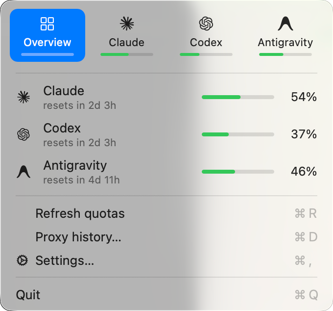
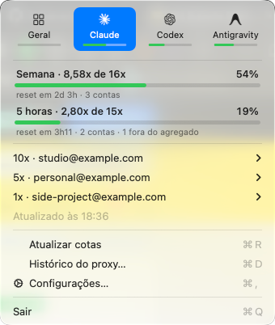
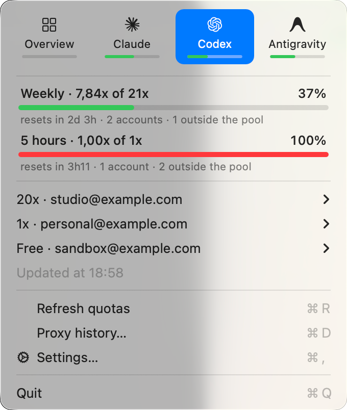
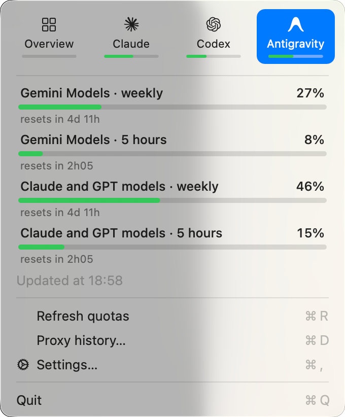
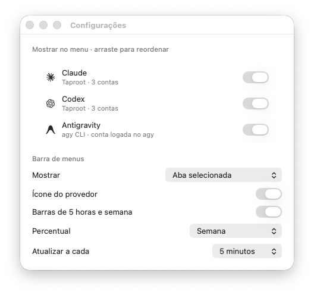

# CodexBar Personal

A small macOS menu bar app for a local CLIProxyAPI-compatible proxy pool (such
as CLIProxyAPI, Taproot, or its fork Proxyhub). It displays Claude and Codex quotas, per-account
plans, weighted paid capacity, reset times, and an on-demand dashboard of proxy
tokens and estimated API costs. It also shows the Antigravity quota of the
signed-in `agy` CLI.

It is a personal, lightweight companion to [CodexBar](https://github.com/steipete/CodexBar):
a separate AppKit executable with no third-party dependencies, WebViews,
transcript scanner, plugin interpreter, widget, or background cost-history
ingestion. It can run alongside CodexBar without touching its data.

## Preview

Screenshots use `--demo`, which shows fictional accounts and quotas. Numbers use
the macOS region of the machine that took them, here Brazil's decimal comma.

<p>
  
  
</p>
<p>
  
  
</p>

Menu bar item, following the selected tab. Claude shows the five-hour meter
above the weekly one; Codex shows a single weekly meter because its five-hour
pool is exhausted and its largest plan has weekly limits only:


Settings:



## Build and run

macOS 14 or newer and Swift 6.2 or newer are required. The standalone AppKit app
builds with Apple's Command Line Tools; full Xcode is not required.

```sh
cd codexbar-personal
bash Scripts/package.sh
open '.build/app/CodexBar Personal.app'
```

The app reads the proxy management key from `CLIPROXY_MANAGEMENT_KEY` in its
environment. When the variable is missing, it relaunches itself once through the
author's secret launcher at `~/Projects/agent-kit/scripts/with-env`, if present;
otherwise the menu shows a credential error. Credentials are never written to the
application bundle, preferences, diagnostics, or command line.

The management API must be on HTTP loopback, by default `127.0.0.1:8317`.
`CODEXBAR_PERSONAL_PROXY_URL` can select another loopback port. Redirects are
rejected. The app reads quotas through the proxy's upstream GET bridge; it does
not generate model responses or refresh credentials.

## Languages

The interface follows the language order in System Settings: English, or
Brazilian Portuguese when it comes first. Numbers, dates and times follow the
region. Strings live in `Sources/PersonalCore/Resources/*.lproj`, keyed by their
English text; a check fails if a key in the code lacks a translation or a
translation changes its format specifiers. To try another language without
changing the system:

```sh
open -n '.build/app/CodexBar Personal.app' --args -AppleLanguages '(pt-BR)'
```

## Menu and settings

The app has a single menu bar item. By default it shows the provider icon, two
CodexBar-style meters (five hours above, weekly below) and the weekly used
percentage. Each part can be turned on or off in the settings, and the
percentage can be weekly, five-hour, both (`13% · 94%`) or none. If every part
is off, the provider icon stays so the item never disappears. Meters fill with
used capacity, like the rest of the app.

The five-hour meter appears only while it matters. It is dropped when no visible
account of the provider has a five-hour window (high plans with weekly limits
only) and when the five-hour pool of the accounts that have one is exhausted,
because weekly-only accounts can still serve. A single taller weekly meter
remains, and the percentages follow the same rule. This is recomputed on every
refresh, so the meter comes back when the window resets. The provider tab in the
menu keeps listing the exhausted five-hour pool with its reset time.

By default the item follows the tab selected in the menu, as in CodexBar:
clicking Codex shows Codex in the menu bar. The Overview tab shows the visible
provider with the highest usage. The settings can instead always show the
highest, or pin one provider. ` !` marks a failed or overdue update.

The menu opens with a provider grid like the full CodexBar: Overview plus one tab
per visible provider, each with a small weekly usage bar. Clicking a tab reopens
the menu on that tab at once, so the menu measures the new content, and the
menu later opens on the last tab. Overview lists one row per provider; clicking
a row opens its tab. Claude and
Codex show the weighted 7d and 5h pools and the accounts; Antigravity shows
every group the CLI reports.

Saved limit resets (Claude's "Reset for free" and Codex rate-limit reset
credits) show under the pools as a count with the next expiry, next to each
account that has one, and one line per reset in the account's submenu. The app
only reads them: the line under the pools and "Use a reset in Proxyhub…" open
Proxyhub's account page, where they are redeemed. macOS reminds you one day and
one hour before a reset expires; clicking the reminder opens the same page.

Open Proxyhub (⌘T) opens the proxy's dashboard in the browser, at the same loopback
address the app reads. Settings… (⌘,) turns providers on and off, reorders them by dragging, and
sets which provider the menu bar follows, its icon, meters and percentages, and
how often quotas refresh (5, 10, 15 or 30 minutes). Changes apply immediately
and live in the app's UserDefaults. A hidden provider is not queried: hiding
Claude or Codex skips those proxy accounts, and hiding Antigravity skips `agy`
entirely. Turning a provider back on refreshes it at once. `--settings` opens the window at launch.

`--demo` replaces live data with fictional accounts and quotas, makes no proxy
or `agy` calls, and keeps its preferences in a separate
`dev.yuri.CodexBarPersonal.demo` domain. It is meant for screenshots:

```sh
open -n '.build/app/CodexBar Personal.app' --args --demo
```

## Behavior and resource limits

- Quotas update on launch, at the configured interval, on wake, or manually. Concurrent
  refreshes share one task, manual attempts are spaced by at least 15 seconds,
  and at most two upstream account reads are in flight.
- Claude's resets come in the usage response (`cedar_ember=1`), at no extra
  request. Codex needs one more read per account, `wham/rate-limit-reset-credits`,
  only after its usage read succeeds. A failed reset read shows nothing for that
  account and keeps its pending reminders, instead of showing zero resets.
- Claude profile tiers are cached for one hour, bounded by the active pool.
  Claude Max 20x counts as 10x capacity, following the author's existing policy.
  Codex plans count as multiples of Plus, per OpenAI's 2026-11-08 figures:
  Plus 1x, Pro 100 (`prolite`) 10x, Pro 200 (`pro`) 20x, Pro 500 (`promax`) 50x.
  Unknown plans, Free accounts, missing windows, and failed accounts are excluded
  from weighted pools and remain visible individually.
- The menu uses native AppKit controls; only the provider grid and usage rows are
  small custom views. Menus rebuild on opening or tab change, not on an
  animation timer. There is no one-second countdown or icon-animation loop.
- The dashboard supports 7, 30 and 90 calendar days. It reads
  `~/.local/share/cpa-usage/usage.db` in a read-only transaction, streams rows and
  retains only daily/model aggregates. Reads are serialized; rapid actions
  coalesce and canceled requests are discarded before scanning.
- Closing the dashboard releases its report, views, table and chart. No history
  scans run while it is closed. With the dashboard open, the five-minute quota
  update also reloads its history.
- OpenAI cached input is a subset of input; Claude cache read/write are separate
  from uncached input. Reasoning is a subset of output. Pricing applies context
  tiers to each request before aggregation. Failed attempts remain counted.
- Unknown model prices retain tokens and request counts and are reported as
  unpriced, without silently making their cost part of the known subtotal.

The dashboard covers the local proxy collector only. Native Claude/Codex history
from before the proxy migration is not imported, added or deduplicated here.
Its original files remain available to the full CodexBar app. This distinction
avoids counting overlapping native and proxy usage twice.

## Antigravity

Antigravity's usage, in the grid and the menu bar, is the highest of the shared
Gemini and Claude/GPT groups for the window. Its tab lists every group the CLI
reports, including model-specific extras such as Argon, with five-hour and
weekly windows and resets. Extras have their own allowance and do not drive the
headline.

Quotas come from `agy -p /usage --output-format json`, the CLI's own usage
report. It sends no model prompt. It refreshes with the other quotas, but runs
separately, so a slow or signed-out `agy` never delays Claude or Codex.

- `ANTIGRAVITY_CLI_PATH` selects the executable. Otherwise `~/.local/bin/agy`,
  `/opt/homebrew/bin/agy` and `/usr/local/bin/agy` are tried.
- Each run uses a private temporary HOME containing only a link to the real
  `~/Library`. The Keychain login keeps working, while MCP servers, settings
  and conversations under `~/.gemini` are not loaded. Without this, every
  report starts all configured MCP servers.
- `open`, `xdg-open` and `BROWSER` point to launchers that fail, so an expired
  login shows an error instead of opening Google sign-in. Run `agy` in Terminal
  to sign in again.
- Automatic CLI updates are disabled for the child. Runs stop after 75 seconds
  and output is capped at 1 MiB. The temporary directory is removed after each
  run; removing it deletes the link, not `~/Library`.

The report has no account identity, so the menu reflects whichever Google
account `agy` is signed in to. `--antigravity` prints the parsed groups for a
diagnostic run.

## Pricing snapshot

The bundle contains only public OpenAI and Anthropic rate tables exported from
CodexBar's existing models.dev cache. It performs no background pricing fetch.
To update the snapshot after refreshing the original app's pricing catalog:

```sh
python3 Scripts/export-pricing.py
bash Scripts/package.sh
```

Historical estimates use this snapshot, not historical invoices or a custom
pricing overlay. For periods spanning price changes, the selected rates need
review. No native history source is modified.

## Verification

```sh
swift run -c release --jobs 2 PersonalCoreChecks
.build/release/CodexBarPersonal --history
.build/release/CodexBarPersonal --antigravity
~/Projects/agent-kit/scripts/with-env .build/release/CodexBarPersonal --probe --history
python3 Scripts/verify-integration.py --quotas
python3 Scripts/test-measure-resources.py
```

`PersonalCoreChecks` executes the actual parser, network orchestration, SQLite
reader and pricing engine. It is a small executable because Command Line Tools
do not ship XCTest or Swift Testing on this host. No real account or Keychain
access is used by the behavior checks. Live `--probe` deliberately omits account
identifiers and response bodies and exits nonzero if any account fails.

For a process's physical footprint, compressed memory and CPU deltas:

```sh
python3 Scripts/measure-resources.py --pid PID --duration 330 \
  --output .build/evidence/idle.json
```

CPU percentages use one logical core as 100%. Physical footprint includes
compressed memory; RSS alone would understate the original app's usage.
CPU counters are converted from Mach ticks with `mach_timebase_info`, rather
than assuming nanoseconds on Apple Silicon.

The diagnostic `--exercise-ui` option rebuilds the real native menu four times
per second without additional quota calls. `--exercise-dashboard` creates and
closes hidden native dashboards every two seconds, including real history reads.
These modes are for bounded stress tests, not normal operation. `--dashboard`
opens the visible dashboard at launch.

## Installation and rollback

The candidate uses bundle identifier `dev.yuri.CodexBarPersonal` and can live
alongside the original app in `~/Applications/CodexBar Personal.app`. It does
not replace `/Applications/CodexBar.app` or change login items. To stop it, use
Quit in its menu; the original app and all existing data remain available.

## License

MIT; see `LICENSE`. Provider icons come from CodexBar under its MIT license; see
`THIRD_PARTY_NOTICES.md`.
